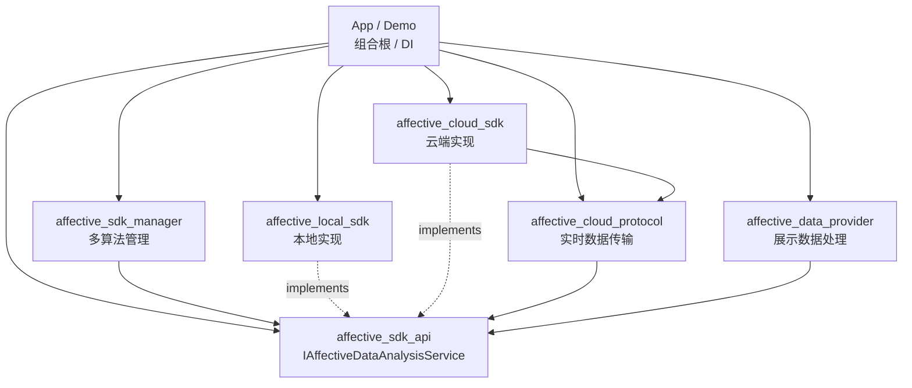

[English Readme](README_EN.md)

# Enter-AffectiveCloud-Android-SDK

- [简介](#简介)
- [架构与组件](#架构与组件)
- [仓库开发初始化](#仓库开发初始化)
- [Demo](#demo)
- [集成](#集成)
  * [源码工程依赖](#源码工程依赖)
  * [权限申请](#权限申请)
- [组件化使用](#组件化使用)
  * [统一 API 与动态切换](#统一-api-与动态切换)
  * [直接使用本地算法](#直接使用本地算法)
  * [同时管理多个算法](#同时管理多个算法)
  * [实时传输与数据展示](#实时传输与数据展示)
- [云端算法接入](#云端算法接入)
- [兼容性策略](#兼容性策略)
- [更新日志](#更新日志)

# 简介

本仓库提供回车情感云 Android SDK 的组件化源码，包括统一 API、本地算法、云端算法、算法管理器、实时传输协议和展示数据处理模块。

如果你要接入云端情感算法，请查看 [affective_cloud_sdk/README.md](affective_cloud_sdk/README.md)。在开始开发前，也请先查看回车情感云的[开发文档](https://docs.affectivecloud.com)，了解情感云平台架构和服务说明，并联系管理员注册测试应用。

如果你只需要本地算法，请查看 `affective_local_sdk`；如果你需要统一本地/云端调用方式，请优先面向 `affective_sdk_api` 中的 `IAffectiveDataAnalysisService` 编程。

# 架构与组件

SDK 的核心设计是由 `affective_sdk_api` 对外暴露稳定操作面，应用主要面向 `IAffectiveDataAnalysisService` 编程；本地算法和云端算法只是这个接口的两个实现。业务需要引用具体能力组件，例如 `affective_local_sdk` 或 `affective_cloud_sdk`，但入口变量、生命周期调用、数据追加和报表获取都保持为 `IAffectiveDataAnalysisService`。运行时切换本地/云端由 App 自己创建或注入对应实现完成，`affective_sdk_api` 不负责服务发现或实例构造。



| 模块 | 职责 | 何时直接依赖 |
| --- | --- | --- |
| `affective_local_sdk` | 提供 `IAffectiveDataAnalysisService` 的本地算法实现，支持无网络分析 | 需要直接使用本地算法，或业务需要在运行时切到本地算法时 |
| `affective_cloud_sdk` | 提供 `IAffectiveDataAnalysisService` 的云端算法实现，连接情感云服务 | 需要直接使用云端算法、云端报表，或业务需要在运行时切到云端算法时 |
| `affective_sdk_manager` | 按 key 注册、启动和隔离多个 `IAffectiveDataAnalysisService` 实例，并向多个算法广播数据 | 本地和云端并行，或同时管理多个设备/算法时 |
| `affective_cloud_protocol` | 将实时生物和情感数据编码为 Web/Socket 可传输的数据 | App 内开启 Web 服务或向外部页面展示实时数据时 |
| `affective_data_provider` | 选择、过滤、缓存和裁剪用于 UI 展示的数据 | 折线图、指标卡等实时展示场景 |
| `affective_sdk_api` | `IAffectiveDataAnalysisService`、公共配置、输入、状态、实时事件和报表模型 | 应用代码需要面向统一接口编程，或需要把本地/云端实现隐藏在同一个接口变量后面时 |

五个产品组件都可以被 App/Demo 直接依赖，但推荐的算法调用面仍是 `affective_sdk_api` 中的 `IAffectiveDataAnalysisService`：Local 和 Cloud 负责提供实现，App 根据配置、网络状态或用户选择决定当前使用哪个实现；需要并行运行或同时管理多个实例时再使用 Manager。`AffectiveServiceWay` 只是服务类型标识，不是 API 层的工厂入口。完整设计见[重构设计文档](doc/tech/affective-sdk-refactoring-design.md)。

# 仓库开发初始化

本仓库通过 Git submodule 记录 `affective_local_sdk/src/main` 对应的算法子仓库提交。父仓库每次提交都会保存子仓库的精确 commit id，用于保证不同设备、CI 和发布流程构建到同一份算法源码。

新设备 clone 后先执行 bootstrap：

**macOS / Linux / Git Bash**

```bash
./scripts/bootstrap.sh
```

**Windows CMD**

```bat
scripts\bootstrap.cmd
```

**Windows PowerShell**

```powershell
powershell -ExecutionPolicy Bypass -File scripts\bootstrap.ps1
```

bootstrap 会执行：

```bash
git submodule update --init --recursive
```

并安装本地 hooks。hooks 会复制到 Git 自己的 hooks 目录，并把 `core.hooksPath` 指向该稳定目录，所以切换到不包含 `.githooks` 的旧分支时仍然可以继续同步：

- 父仓库 `post-checkout`：切换父仓库分支时，自动切换子仓库到对应分支。
- 子仓库 `post-commit`：子仓库提交后，自动在父仓库中 stage `affective_local_sdk/src/main` 的 submodule commit id。

分支映射规则：

| 父仓库分支 | 子仓库分支 |
| --- | --- |
| `dev_2.0` | `algorithm-android-dev_2.0` |
| `team/dev_1.2.3` | `algorithm-android-team/dev_1.2.3` |
| `publish_1.2.3` | `algorithm-android-publish_1.2.3` |
| `svm-main` | `svm-main` |

当父仓库切到一个新建分支时，如果对应的子仓库分支不存在，hook 会从父仓库当前记录的 submodule commit 创建该子仓库分支。

如果已经切换了父仓库分支，但子仓库没有同步到对应分支，重新执行 bootstrap 或安装脚本即可立即同步当前分支：

```bash
./scripts/install_submodule_branch_hooks.sh
```

默认情况下，子仓库提交后只会自动 stage 父仓库中的 submodule 指针，需要开发者手动提交父仓库。如果需要子仓库提交后自动创建父仓库指针提交，可以临时设置：

```bash
SUBMODULE_SYNC_AUTO_PARENT_COMMIT=1 git -C affective_local_sdk/src/main commit -m "message"
```

> Git hooks 是本机配置，不会随 Git 自动启用。每台新设备都需要执行一次 bootstrap。

# Demo

**下载**

[demo.apk](http://fir.entertech.cn/gb3a)

[Pad端Demo](https://github.com/Entertech/Enter-ACDemo-Pad-Android)

**说明**

更多demo的操作说明可以查看[回车生物电采集模块演示 demo](https://github.com/Entertech/Enter-AffectiveCloud-Android-SDK/tree/master/demo)

另外我们还提供了一个心流演示应用，其集成了蓝牙SDK，蓝牙设备管理SDK，情感云SDK等功能，详细请查看[心流演示应用](https://github.com/Entertech/Enter-Affective-Cloud-Demo-Android)

# 集成

当前完整组件组合要求 `minSdk 24`。源码构建使用 Android SDK 36；使用 `affective_sdk_manager` 时请将 Java/Kotlin JVM target 配置为 17。

### 源码工程依赖

仓库内的 Demo 直接组合五个产品组件。只添加业务需要的组件即可；若代码会通过 `IAffectiveDataAnalysisService` 统一操作本地/云端，建议显式依赖 `affective_sdk_api`，并同时依赖需要被动态选择的实现组件。

```groovy
dependencies {
    implementation project(':affective_local_sdk')
    implementation project(':affective_cloud_sdk')
    implementation project(':affective_sdk_manager')
    implementation project(':affective_cloud_protocol')
    implementation project(':affective_data_provider')

    // 公共契约；只使用能够 api 传递该依赖的组件时可以省略
    implementation project(':affective_sdk_api')
}
```

当前公开接入以源码工程依赖和内部发布包为准；发布包坐标、仓库地址和版本号请以项目发布说明或交付文档为准。

云端算法的快速接入方式见 [affective_cloud_sdk/README.md](affective_cloud_sdk/README.md)。

### 权限申请

使用云端算法或 Web 实时传输时需要网络权限：

```xml
<uses-permission android:name="android.permission.INTERNET"/>
<uses-permission android:name="android.permission.ACCESS_NETWORK_STATE"/>
```

# 组件化使用

### 统一 API 与动态切换

以前通过 `IAffectiveDataAnalysisService` 实例进行连接、启动、订阅、追加数据和获取报表的方式仍然是主入口。`affective_local_sdk` 和 `affective_cloud_sdk` 都提供该接口的实现，应用可以根据用户配置、网络状态或业务策略选择本地或云端。

关键点：

- 业务代码依赖的是具体能力组件：只用本地就依赖 `affective_local_sdk`，只用云端就依赖 `affective_cloud_sdk`，需要动态切换就同时依赖两者。
- 业务层持有的入口类型仍然是 `IAffectiveDataAnalysisService`，因此连接、启动、追加数据、订阅和报表获取的调用面一致。
- `affective_sdk_api` 不提供 `getService` 或任何服务发现逻辑；实现实例由 App 自己创建，或由业务自己的 DI 容器提供。
- `AffectiveManager` 的默认初始化不会自动发现服务；业务必须先 `registerAffectiveService(...)`、调用带默认实例的 `getAffectiveService(key, default)`，或在子类中重写 `initAffectiveService(...)`。

```kotlin
enum class AlgorithmMode {
    Local,
    Cloud,
}

fun createAffectiveService(mode: AlgorithmMode): IAffectiveDataAnalysisService =
    when (mode) {
        AlgorithmMode.Local -> EnterAffectiveLocalService()
        AlgorithmMode.Cloud -> EnterAffectiveCloudService()
    }

var affectiveService: IAffectiveDataAnalysisService =
    createAffectiveService(AlgorithmMode.Local)

// 切换到云端前，先结束/释放当前会话，再替换成新的实现实例。
lifecycleScope.launch {
    affectiveService.awaitFinishAffectiveService()
    affectiveService.closeAffectiveServiceConnection()

    affectiveService = createAffectiveService(AlgorithmMode.Cloud)
    affectiveService.awaitConnectAffectiveService(cloudConfig)
    affectiveService.awaitStartAffectiveService()
}
```

如果只需要单一算法，直接持有一个 `IAffectiveDataAnalysisService` 变量即可。需要动态切换时，切换的是变量背后的实现实例，不是调用方式；需要本地和云端同时运行时，不要反复替换同一个变量，使用 `AffectiveManager` 按 key 注册本地和云端服务即可。

### 直接使用本地算法

业务只需要依赖 `affective_local_sdk` 和 `affective_sdk_api`，入口仍然是 `IAffectiveDataAnalysisService`。如果希望使用协程和 Flow，可以直接使用 `IAffectiveDataAnalysisService` 的扩展方法，不需要经过 Manager，也不需要额外包装成其他入口。硬件数据建议通过 `append(AffectiveInput)` 追加，旧的 `appendByteArrayData`、`appendIntData`、`appendIntListData` 仅保留兼容。

```kotlin
val localService: IAffectiveDataAnalysisService = EnterAffectiveLocalService()

val eventJob = lifecycleScope.launch {
    localService.realtimeEvents(sourceKey = "local").collect { event ->
        demoPipeline.onEvent(event)
    }
}

lifecycleScope.launch {
    val connected = localService.awaitConnectAffectiveService(EnterAffectiveConfigProxy())
    if (connected is AffectiveServiceResult.Success) {
        val started = localService.awaitStartAffectiveService()
        if (started is AffectiveServiceResult.Success) {
            localService.append(AffectiveInput.EegBytes(bytes))
            localService.append(AffectiveInput.HeartRate(heartRate))
        }
    }
}

// 页面或会话结束时
lifecycleScope.launch {
    eventJob.cancelAndJoin()
    localService.awaitFinishAffectiveService()
    localService.closeAffectiveServiceConnection()
}
```

### 同时管理多个算法

`AffectiveManager` 使用显式 key 管理 `IAffectiveDataAnalysisService` 实例。本地和云端服务可以独立启动，也可以接收同一份硬件数据；某个算法追加数据失败不会阻断其他算法。

```kotlin
val manager = AffectiveManager<String>()
manager.registerAffectiveService("local", EnterAffectiveLocalService())
manager.registerAffectiveService("cloud", EnterAffectiveCloudService())

manager.connectAndStartAffectiveService("local")
manager.connectAndStartAffectiveService("cloud", cloudConfig)
manager.subscribeData("local")
manager.subscribeData("cloud")

// 在两个服务的启动回调成功后广播硬件数据
manager.appendEEGDataToAll(bytes)
manager.appendHeartRateDataToAll(heartRate)
```

### 实时传输与数据展示

- `GsonRealtimeProtocolEncoder` 输出带 `version`、`type`、`timestampMillis` 和类型化 `payload` 的实时消息。
- `LegacyCloudProtocolEncoder` 保留旧 Web 展示协议的 JSON 结构。
- `DisplayDataProvider` 可以组合 selector、filter 和 window policy；`AttentionListCacheDataProvider`、`RelaxationListCacheDataProvider`、`HrListCacheDataProvider` 提供常用展示缓存。
- Demo 中的 [`AffectiveDemoPipeline`](demo/src/main/java/cn/entertech/biomoduledemo/affective/AffectiveDemoPipeline.kt) 展示了如何把算法事件同时送入传输层和展示层。

# 云端算法接入

云端情感算法、云端报表、原始数据存储和旧版 `EnterAffectiveCloudManager` 兼容接入方式，请查看 [affective_cloud_sdk/README.md](affective_cloud_sdk/README.md)。


# 兼容性策略

- 仅 `affective_sdk_api` 模块承诺源码兼容和二进制兼容；其已有 public/protected API 在兼容周期内不会删除或修改 JVM 签名。
- 新能力优先通过新增类型和方法提供。旧接口可以标记为 `@Deprecated`，但会继续保留，待后续明确的破坏性版本再移除。
- `affective_local_sdk`、`affective_cloud_sdk`、`affective_sdk_manager`、`affective_cloud_protocol` 和 `affective_data_provider` 不在源码/二进制兼容承诺范围内，升级时应锁定同一发布版本并执行集成测试。
- 本轮重构没有调整 `affective_cloud_sdk` 的实现；旧云端接入方式继续可用。

# 更新日志
[更新日志](https://github.com/Entertech/Enter-AffectiveCloud-Android-SDK/wiki/%E6%9B%B4%E6%96%B0%E6%97%A5%E5%BF%97)

