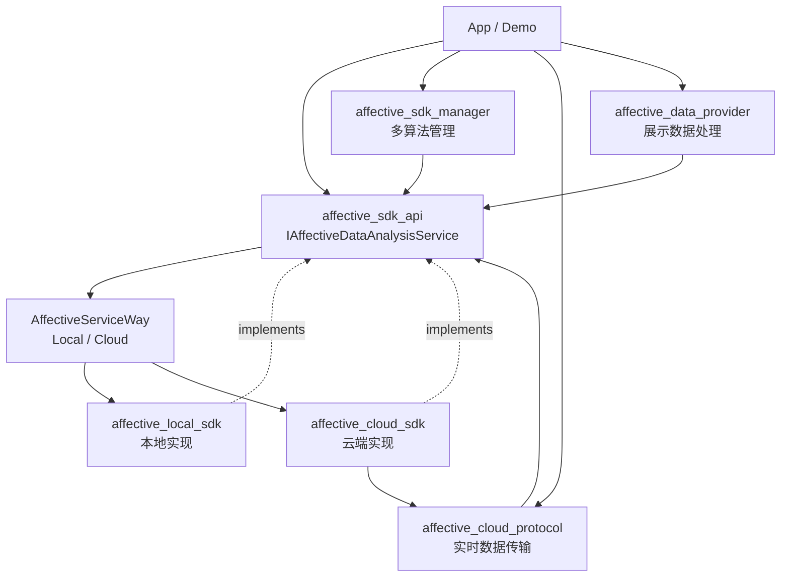

[English Readme](README_EN.md)

# Enter-AffectiveCloud-Android-SDK [](https://maven-badges.herokuapp.com/maven-central/cn.entertech.android/affectivecloud)

- [简介](#简介)
- [架构与组件](#架构与组件)
- [仓库开发初始化](#仓库开发初始化)
- [Demo](#demo)
- [集成](#集成)
  * [源码工程依赖](#源码工程依赖)
  * [Maven 依赖](#maven-依赖)
  * [权限申请](#权限申请)
- [组件化使用](#组件化使用)
  * [统一 API 与动态切换](#统一-api-与动态切换)
  * [直接使用本地算法](#直接使用本地算法)
  * [同时管理多个算法](#同时管理多个算法)
  * [实时传输与数据展示](#实时传输与数据展示)
- [快速接入](#快速接入)
  * [1.初始化](#1初始化)
  * [2.添加实时数据监听](#2添加实时数据监听)
  * [3.上传数据](#3上传数据)
  * [4.获取报表](#4获取报表)
  * [5.资源释放](#5资源释放)
- [原始数据操作](#原始数据操作)
  * [是否保存原始数据](#是否保存原始数据)
  * [原始数据的查询和删除](#原始数据的查询和删除)
      - [初始化](#初始化)
      - [授权](#授权)
      - [查询](#查询)
      - [删除](#删除)
      - [Record数据说明](#Record数据说明)
- [兼容性策略](#兼容性策略)
- [详细API功能说明](#详细api功能说明)
- [更新日志](#更新日志)

# 简介

回车情感云可以根据用户的脑波数据和心率数据来进行高级情绪情感数据分析的一个云算法平台，同时能给出包括：放松度、注意力、愉悦值，压力值、激动度（内测）在内的多种情绪情感值。详情请查看[官网](https://www.entertech.cn)。

在开始开发前，请先查看回车情感云的[开发文档](https://docs.affectivecloud.com)，了解情感云平台的架构和所能提供的服务具体说明，确定好你的应用中所需要的服务。你还需要联系管理员注册好测试应用，然后再进行开发。

为了方便你进行 Android 平台的快速开发，我们提供了情感云快速开发 SDK，通过本 SDK 你可以快速地将情感云的能力集成到你的 app 中。

# 架构与组件

SDK 的核心设计是由 `affective_sdk_api` 对外暴露稳定操作面，应用主要面向 `IAffectiveDataAnalysisService` 编程；本地算法和云端算法只是这个接口的两个实现。应用可以在运行时按 `AffectiveServiceWay` 选择本地或云端实现，也可以直接使用本地/云端组件；Manager 用于多算法实例并行、隔离和广播输入。



| 模块 | 职责 | 何时直接依赖 |
| --- | --- | --- |
| `affective_local_sdk` | 提供 `IAffectiveDataAnalysisService` 的本地算法实现，支持无网络分析 | 需要本地实现，或需要在运行时切到本地算法时 |
| `affective_cloud_sdk` | 提供 `IAffectiveDataAnalysisService` 的云端算法实现，连接情感云服务 | 需要云端实现、云端报表，或需要在运行时切到云端算法时 |
| `affective_sdk_manager` | 按 key 注册、启动和隔离多个 `IAffectiveDataAnalysisService` 实例，并向多个算法广播数据 | 本地和云端并行，或同时管理多个设备/算法时 |
| `affective_cloud_protocol` | 将实时生物和情感数据编码为 Web/Socket 可传输的数据 | App 内开启 Web 服务或向外部页面展示实时数据时 |
| `affective_data_provider` | 选择、过滤、缓存和裁剪用于 UI 展示的数据 | 折线图、指标卡等实时展示场景 |
| `affective_sdk_api` | `IAffectiveDataAnalysisService`、公共配置、输入、状态、实时事件和报表模型 | 应用代码需要面向统一接口编程，或需要动态选择本地/云端实现时 |

五个产品组件都可以被 App/Demo 直接依赖，但推荐的算法调用面仍是 `affective_sdk_api` 中的 `IAffectiveDataAnalysisService`：Local 和 Cloud 负责提供实现，App 根据配置选择其中一个；需要并行运行或同时管理多个实例时再使用 Manager。完整设计见[重构设计文档](doc/tech/affective-sdk-refactoring-design.md)。

# 仓库开发初始化

本仓库通过 Git submodule 记录 `affective_local_sdk/src/main` 对应的算法子仓库提交。父仓库每次提交都会保存子仓库的精确 commit id，用于保证不同设备、CI 和发布流程构建到同一份算法源码。

新设备 clone 后先执行 bootstrap：

**macOS / Linux / Git Bash**

```bash
./scripts/bootstrap.sh
```

**Windows CMD**

```bat
scripts\bootstrap.cmd
```

**Windows PowerShell**

```powershell
powershell -ExecutionPolicy Bypass -File scripts\bootstrap.ps1
```

bootstrap 会执行：

```bash
git submodule update --init --recursive
```

并安装本地 hooks。hooks 会复制到 Git 自己的 hooks 目录，并把 `core.hooksPath` 指向该稳定目录，所以切换到不包含 `.githooks` 的旧分支时仍然可以继续同步：

- 父仓库 `post-checkout`：切换父仓库分支时，自动切换子仓库到对应分支。
- 子仓库 `post-commit`：子仓库提交后，自动在父仓库中 stage `affective_local_sdk/src/main` 的 submodule commit id。

分支映射规则：

| 父仓库分支 | 子仓库分支 |
| --- | --- |
| `dev_2.0` | `algorithm-android-dev_2.0` |
| `team/dev_1.2.3` | `algorithm-android-team/dev_1.2.3` |
| `publish_1.2.3` | `algorithm-android-publish_1.2.3` |
| `svm-main` | `svm-main` |

当父仓库切到一个新建分支时，如果对应的子仓库分支不存在，hook 会从父仓库当前记录的 submodule commit 创建该子仓库分支。

如果已经切换了父仓库分支，但子仓库没有同步到对应分支，重新执行 bootstrap 或安装脚本即可立即同步当前分支：

```bash
./scripts/install_submodule_branch_hooks.sh
```

默认情况下，子仓库提交后只会自动 stage 父仓库中的 submodule 指针，需要开发者手动提交父仓库。如果需要子仓库提交后自动创建父仓库指针提交，可以临时设置：

```bash
SUBMODULE_SYNC_AUTO_PARENT_COMMIT=1 git -C affective_local_sdk/src/main commit -m "message"
```

> Git hooks 是本机配置，不会随 Git 自动启用。每台新设备都需要执行一次 bootstrap。

# Demo

**下载**

[demo.apk](http://fir.entertech.cn/gb3a)

[Pad端Demo](https://github.com/Entertech/Enter-ACDemo-Pad-Android)

**说明**

更多demo的操作说明可以查看[回车生物电采集模块演示 demo](https://github.com/Entertech/Enter-AffectiveCloud-Android-SDK/tree/master/demo)

另外我们还提供了一个心流演示应用，其集成了蓝牙SDK，蓝牙设备管理SDK，情感云SDK等功能，详细请查看[心流演示应用](https://github.com/Entertech/Enter-Affective-Cloud-Demo-Android)

# 集成

当前完整组件组合要求 `minSdk 24`。源码构建使用 Android SDK 36；使用 `affective_sdk_manager` 时请将 Java/Kotlin JVM target 配置为 17。

### 源码工程依赖

仓库内的 Demo 直接组合五个产品组件。只添加业务需要的组件即可；若代码会通过 `IAffectiveDataAnalysisService` 统一操作本地/云端，建议显式依赖 `affective_sdk_api`，并同时依赖需要被动态选择的实现组件。

```groovy
dependencies {
    implementation project(':affective_local_sdk')
    implementation project(':affective_cloud_sdk')
    implementation project(':affective_sdk_manager')
    implementation project(':affective_cloud_protocol')
    implementation project(':affective_data_provider')

    // 公共契约；只使用能够 api 传递该依赖的组件时可以省略
    implementation project(':affective_sdk_api')
}
```

### Maven 依赖

在项目仓库配置中启用 Maven Central：

```groovy
allprojects {
    repositories {
        mavenCentral()
    }
}
```

按需添加组件，并将 `<version>` 替换成发布说明中的同一版本：

```groovy
def affectiveSdkVersion = '<version>'

dependencies {
    implementation "cn.entertech.android:affective_sdk_api:$affectiveSdkVersion"
    implementation "cn.entertech.android:sdk-affective-offline-sdk:$affectiveSdkVersion"
    implementation "cn.entertech.android:affective_cloud_sdk:$affectiveSdkVersion"
    implementation "cn.entertech.android:affective-sdk-manager:$affectiveSdkVersion"
    implementation "cn.entertech.android:affective-cloud-protocol:$affectiveSdkVersion"
    implementation "cn.entertech.android:affective-data-provider:$affectiveSdkVersion"
}
```

本地算法还提供 `breath`、`obsession`、`flowtime`、`sdk` 项目变体，以及带 `-authentication` 后缀的鉴权变体，请选择与交付包一致的 artifact。只维护旧版云端单组件接入的项目仍可使用：

```groovy
implementation 'cn.entertech.android:affectivecloud:2.1.0'
```

下面“快速接入”章节保留了该兼容入口的使用方式；新项目建议按上面的组件职责选择依赖。

### 权限申请

使用云端算法或 Web 实时传输时需要网络权限：

```xml
<uses-permission android:name="android.permission.INTERNET"/>
<uses-permission android:name="android.permission.ACCESS_NETWORK_STATE"/>
```

# 组件化使用

### 统一 API 与动态切换

以前通过 `IAffectiveDataAnalysisService` 实例进行连接、启动、订阅、追加数据和获取报表的方式仍然是主入口。`affective_local_sdk` 和 `affective_cloud_sdk` 都提供该接口的实现，应用可以根据用户配置、网络状态或业务策略选择本地或云端。

```kotlin
fun createAffectiveService(useCloud: Boolean): IAffectiveDataAnalysisService {
    return if (useCloud) {
        EnterAffectiveCloudService()
    } else {
        EnterAffectiveLocalService()
    }
}

var affectiveService = createAffectiveService(useCloud = false)

// 切换到云端前，先结束/释放当前会话，再获取新的实现实例。
affectiveService.finishAffectiveService(finishListener)
affectiveService.closeAffectiveServiceConnection()
affectiveService = createAffectiveService(useCloud = true)
affectiveService.connectAffectiveServiceConnection(connectionListener, cloudConfig)
```

`IAffectiveDataAnalysisService` 只限定公开方法，不负责构造或发现实现。业务可以直接构造 Local/Cloud 服务，也可以交给自己的 DI 容器管理。如果需要保留多个算法实例并行运行，不要反复替换同一个变量，使用 `AffectiveManager` 按 key 注册本地和云端服务即可。

### 直接使用本地算法

业务只需要依赖 `affective_local_sdk` 和 `affective_sdk_api`，入口仍然是 `IAffectiveDataAnalysisService`。如果希望使用协程和 Flow，可以直接使用 `IAffectiveDataAnalysisService` 的扩展方法，不需要经过 Manager，也不需要额外包装成其他入口。

```kotlin
val localService: IAffectiveDataAnalysisService = EnterAffectiveLocalService()

val eventJob = lifecycleScope.launch {
    localService.realtimeEvents(sourceKey = "local").collect { event ->
        demoPipeline.onEvent(event)
    }
}

lifecycleScope.launch {
    val connected = localService.awaitConnectAffectiveService(EnterAffectiveConfigProxy())
    if (connected is AffectiveServiceResult.Success) {
        val started = localService.awaitStartAffectiveService()
        if (started is AffectiveServiceResult.Success) {
            localService.append(AffectiveInput.EegBytes(bytes))
            localService.append(AffectiveInput.HeartRate(heartRate))
        }
    }
}

// 页面或会话结束时
lifecycleScope.launch {
    eventJob.cancelAndJoin()
    localAlgorithm?.finish()
    localAlgorithm?.disconnect()
}
```

### 同时管理多个算法

`AffectiveManager` 使用显式 key 管理 `IAffectiveDataAnalysisService` 实例。本地和云端服务可以独立启动，也可以接收同一份硬件数据；某个算法追加数据失败不会阻断其他算法。

```kotlin
val manager = AffectiveManager<String>()
manager.registerAffectiveService("local", EnterAffectiveLocalService())
manager.registerAffectiveService("cloud", EnterAffectiveCloudService())

manager.connectAndStartAffectiveService("local")
manager.connectAndStartAffectiveService("cloud", cloudConfig)
manager.subscribeData("local")
manager.subscribeData("cloud")

// 在两个服务的启动回调成功后广播硬件数据
manager.appendEEGDataToAll(bytes)
manager.appendHeartRateDataToAll(heartRate)
```

### 实时传输与数据展示

- `GsonRealtimeProtocolEncoder` 输出带 `version`、`type`、`timestampMillis` 和类型化 `payload` 的实时消息。
- `LegacyCloudProtocolEncoder` 保留旧 Web 展示协议的 JSON 结构。
- `DisplayDataProvider` 可以组合 selector、filter 和 window policy；`AttentionListCacheDataProvider`、`RelaxationListCacheDataProvider`、`HrListCacheDataProvider` 提供常用展示缓存。
- Demo 中的 [`AffectiveDemoPipeline`](demo/src/main/java/cn/entertech/biomoduledemo/affective/AffectiveDemoPipeline.kt) 展示了如何把算法事件同时送入传输层和展示层。

# 快速接入

本节为既有云端 API 的兼容接入方式。SDK 提供了 `EnterAffectiveCloudManager`，使用该类只需要几步就可以完成客户端与情感云平台的数据交互。新项目也可以直接创建 `EnterAffectiveCloudService`，按需调用 `IAffectiveDataAnalysisService` 的协程和 Flow 扩展方法，或将 `EnterAffectiveCloudService` 注册到 `AffectiveManager`。

##  1.初始化

```kotlin
//基础服务
var availableBioServices = listOf(Service.EEG, Service.HR)
//情感云服务(需向官方申请)
var availableAffectiveServices = listOf(Service.ATTENTION, Service.PRESSURE, Service.AROUSAL, Service.SLEEP)
//基础服务订阅参数
var biodataSubscribeParams = BiodataSubscribeParams.Builder()
            .requestEEG//订阅所有eeg数据
            .requestHr//订阅所有心率相关数据
            .build()
//情感服务订阅参数
var affectiveSubscribeParams = AffectiveSubscribeParams.Builder()
            .requestSleep()//订阅所有sleep服务数据
            .requestAttention()//订阅attention数据
            .requestRelaxation()//订阅relaxation数据
            .requestPressure()//订阅pressure数据
            .requestPleasure()//订阅pleasure数据
            .build()
//配置项
var enterAffectiveCloudConfig = EnterAffectiveCloudConfig.Builder(APP_KEY, APP_SECRET, USER_ID)
            .url(websocketAddress)//配置websocket地址
            .timeout(10000)//配置websocket连接超时时间 单位：ms
            .availableBiodataServices(availableBioServices)//可用的基础服务
            .availableAffectiveServices(availableAffectiveServices)//可用的情感服务
            .biodataSubscribeParams(biodataSubscribeParams!!)//基础服务订阅参数
            .affectiveSubscribeParams(affectiveSubscribeParams!!)//情感服务订阅参数
            .build()
//创建管理类
var enterAffectiveCloudManager = EnterAffectiveCloudManager(enterAffectiveCloudConfig)
//初始化SDK
enterAffectiveCloudManager?.init(object : Callback {
            override fun onError(error: Error?) {
                messageReceiveFragment.appendMessageToScreen("初始化失败：${error.toString()}")
            }
            override fun onSuccess() {
                messageReceiveFragment.appendMessageToScreen("初始化成功")
            }
        })
```

**参数说明**

|参数|类型|说明|
|:--:|:--:|:--:|
| websocketAddress | String | 情感云服务器链接，详见[链接](https://docs.affectivecloud.com/🎙接口协议/1.%20综述.html#正式) |

|参数|类型|说明|
|:--:|:--:|:--:|
| APP_KEY | String | 由我们后台生成的：App Key |
| APP_SECRET | String | 由我们后台生成的：App Secret|
| USER_ID | String | 你 app 当前用户的 id，如手机号、id 号，昵称等，需要保证唯一性。详见[userID](https://docs.affectivecloud.com/🎙接口协议/3.%20会话协议.html#userID) |

## 2.添加实时数据监听

注意如果要想实时返回数据，需要在上面步骤中配置订阅相应数据字段，否则监听将无数据返回。

实时数据字段说明详见：[基础数据字段说明](https://docs.affectivecloud.cn/%F0%9F%8E%99%E6%8E%A5%E5%8F%A3%E5%8D%8F%E8%AE%AE/4.%20%E7%94%9F%E7%89%A9%E6%95%B0%E6%8D%AE%E5%9F%BA%E7%A1%80%E5%88%86%E6%9E%90%E6%9C%8D%E5%8A%A1%E5%8D%8F%E8%AE%AE.html#%E5%AE%9E%E6%97%B6%E7%94%9F%E7%89%A9%E6%95%B0%E6%8D%AE%E5%88%86%E6%9E%90%E8%BF%94%E5%9B%9E%E5%80%BC),[情感数据字段说明](https://docs.affectivecloud.cn/%F0%9F%8E%99%E6%8E%A5%E5%8F%A3%E5%8D%8F%E8%AE%AE/5.%20%E6%83%85%E6%84%9F%E8%AE%A1%E7%AE%97%E6%9C%8D%E5%8A%A1%E5%8D%8F%E8%AE%AE.html#%E6%83%85%E6%84%9F%E4%BA%91%E8%AE%A1%E7%AE%97%E5%AE%9E%E6%97%B6%E8%BF%94%E5%9B%9E%E6%95%B0%E6%8D%AE%E6%9C%8D%E5%8A%A1%E5%92%8C%E5%8F%82%E6%95%B0%E9%A1%B9)

```kotlin
enterAffectiveCloudManager!!.addBiodataRealtimeListener {
            messageReceiveFragment.appendMessageToScreen("基础服务实时数据：${it.toString()}")
        }
enterAffectiveCloudManager!!.addAffectiveDataRealtimeListener {
            messageReceiveFragment.appendMessageToScreen("情感服务实时数据：${it.toString()}")
        }
```

## 3.上传数据

**上传脑波数据**

```kotlin
enterAffectiveCloudManager?.appendEEGData(bytes)
```

**上传心率数据**

```kotlin
enterAffectiveCloudManager?.appendHeartRateData(heartRate)
```

> 注意：上面数据都直接由硬件返回，硬件有数据返回就调用相应的方法，传入数据即可，无需做其他处理。

## 4.获取报表

相应返回的 report 字段，由之前配置决定。具体字段的详细描述见[生物数据基础报表参数](https://docs.affectivecloud.cn/%F0%9F%8E%99%E6%8E%A5%E5%8F%A3%E5%8D%8F%E8%AE%AE/4.%20%E7%94%9F%E7%89%A9%E6%95%B0%E6%8D%AE%E5%9F%BA%E7%A1%80%E5%88%86%E6%9E%90%E6%9C%8D%E5%8A%A1%E5%8D%8F%E8%AE%AE.html#biodata-report)和[情感计算报表参数](https://docs.affectivecloud.cn/%F0%9F%8E%99%E6%8E%A5%E5%8F%A3%E5%8D%8F%E8%AE%AE/5.%20%E6%83%85%E6%84%9F%E8%AE%A1%E7%AE%97%E6%9C%8D%E5%8A%A1%E5%8D%8F%E8%AE%AE.html#affective-report)。

```kotlin
enterAffectiveCloudManager?.getBiodataReport(object : Callback2<HashMap<Any, Any?>> {
            override fun onSuccess(t: HashMap<Any, Any?>?) {
                messageReceiveFragment.appendMessageToScreen("基础报表：${t.toString()}")
            }
            override fun onError(error: Error?) {
                messageReceiveFragment.appendMessageToScreen("基础报表出错：${error.toString()}")
            }
        })
enterAffectiveCloudManager?.getAffectiveDataReport(object : Callback2<HashMap<Any, Any?>> {
            override fun onSuccess(t: HashMap<Any, Any?>?) {
                messageReceiveFragment.appendMessageToScreen("情感报表：${t.toString()}")
            }
            override fun onError(error: Error?) {
                messageReceiveFragment.appendMessageToScreen("情感报表出错：${error.toString()}")
            }
        })
```

## 5.资源释放

注意，每次使用完情感云服务都需调用如下`release`方法来释放资源，否则会面临持续扣费的风险

```kotlin
enterAffectiveCloudManager?.release(object : Callback {
            override fun onSuccess() {
                messageReceiveFragment.appendMessageToScreen("情感云已成功断开！")
            }
            override fun onError(error: Error?) {
                messageReceiveFragment.appendMessageToScreen("情感云断开失败：${error}")
            }
        })
```
# 原始数据操作

## 是否保存原始数据

在情感云初始化时可传入`allow`参数，来指定服务器是否保存当前会话的原始数据。

```kotlin
var storageSettings = StorageSettings.Builder()
		.allowStoreRawData(true)// whether to allow the raw data to be saved on the server
		.build()

var enterAffectiveCloudConfig =
        EnterAffectiveCloudConfig.Builder(appKey!!, appSecret!!, USER_ID)
            .storageSettings(storageSettings) //storage settings
            .otherParams(otherParams)  //other params,reference the docs above
            .build()
```


## 原始数据的查询和删除

可以通过`AffectiveCloudSourceDataApi`来查询及删除原始数据

#### 初始化

```kotlin

var affectiveSourceDataApi = AffectiveCloudSourceDataApiFactory.createApi(serverUrl,APP_KEY,APP_SECRET,USER_ID)

```

#### 授权

对原始数据进行操作前需进行权限认证

```kotlin
affectiveSourceDataApi.auth(fun(token){
    Log.d("AffectiveCloudSourceDataApi","auth success ${token}")
},fun(error){
    Log.d("AffectiveCloudSourceDataApi","auth failed ${error}")
})
```

#### 查询

**查询当前账户所有数据**

```kotlin
affectiveSourceDataApi.getSourceDataPageList(1,10,fun(lists){
    Log.d("AffectiveCloudSourceDataApi","get records list success:${lists}")
},fun(error){
    Log.d("AffectiveCloudSourceDataApi","get records list failed:${error}")
})
```

**根据用户ID查询**

```kotlin
affectiveSourceDataApi.getSourceDataByUserId(userId, fun(lists) {
    Log.d("AffectiveCloudSourceDataApi","get records list success:${lists}")
}, fun(error) {
    Log.d("AffectiveCloudSourceDataApi","get records list failed:${error}")
})
```

**根据Record ID 查询**

```kotlin
affectiveSourceDataApi.getSourceDataById(recordId, fun(lists) {
    Log.d("AffectiveCloudSourceDataApi","get records list success:${lists}")
}, fun(error) {
    Log.d("AffectiveCloudSourceDataApi","get records list failed:${error}")
})
```

#### 删除

**根据Record ID删除**

````kotlin
affectiveSourceDataApi.deleteSourceDataRecordById(recordId, fun() {
    Log.d("AffectiveCloudSourceDataApi","delete record success")
}, fun(error) {
    Log.d("AffectiveCloudSourceDataApi","delete record failed")
})
````

#### Record数据说明

| 参数       | 类型   | 说明                              |
| ---------- | ------ | --------------------------------- |
| record_id  | Int    | record id                         |
| client_id  | String | 客户端 id (user id 的MD5加密格式) |
| session_id | String | 会话id                            |
| device     | String | 设备                              |
| data_type  | String | 数据类型： eeg 、hr               |
| start_time | String | 会话开始时间                      |
| close_time | String | 会话结束时间                      |
| rec        | String | 标签                              |
| sex        | String | 性别 m:男；f:女                   |
| age        | Int    | 年龄                              |
| url        | String | 原始数据文件路径                  |
| gmt_create | String | Record创建时间                    |
| gmt_modify | String | Record最后修改时间                |
| app        | Int    | 平台                              |
| mode       | List   | 模式                              |
| case       | List   | 场景                              |


# 兼容性策略

- 仅 `affective_sdk_api` 模块承诺源码兼容和二进制兼容；其已有 public/protected API 在兼容周期内不会删除或修改 JVM 签名。
- 新能力优先通过新增类型和方法提供。旧接口可以标记为 `@Deprecated`，但会继续保留，待后续明确的破坏性版本再移除。
- `affective_local_sdk`、`affective_cloud_sdk`、`affective_sdk_manager`、`affective_cloud_protocol` 和 `affective_data_provider` 不在源码/二进制兼容承诺范围内，升级时应锁定同一发布版本并执行集成测试。
- 本轮重构没有调整 `affective_cloud_sdk` 的实现；旧云端接入方式继续可用。

# 详细API功能说明

如果你需要根据不同场景灵活使用情感云服务，可以使用`EnterAffectiveCloudApi`来调用相应API，该类封装了所有情感云服务对外的接口。更加详情的情感云API可以查看[情感云详细API功能说明](https://github.com/Entertech/Enter-AffectiveCloud-Android-SDK/blob/master/media/%E6%83%85%E6%84%9F%E4%BA%91%E8%AF%A6%E7%BB%86API%E5%8A%9F%E8%83%BD%E8%AF%B4%E6%98%8E.md)

# 更新日志
[更新日志](https://github.com/Entertech/Enter-AffectiveCloud-Android-SDK/wiki/%E6%9B%B4%E6%96%B0%E6%97%A5%E5%BF%97)


