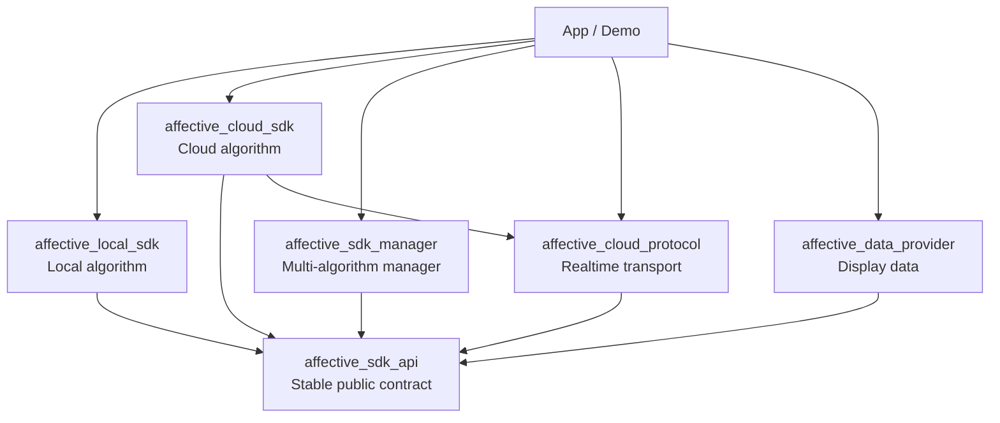

# Enter-AffectiveCloud-Android-SDK [](https://maven-badges.herokuapp.com/maven-central/cn.entertech.android/affectivecloud)

[中文说明](README.md)

- [Introduction](#introduction)
- [Architecture and Components](#architecture-and-components)
- [Repository Setup](#repository-setup)
- [Demo](#demo)
- [Getting Started](#getting-started)
  * [Source Project Dependencies](#source-project-dependencies)
  * [Maven Dependencies](#maven-dependencies)
  * [Permissions](#permissions)
- [Using the Components](#using-the-components)
  * [Use the Local Algorithm Directly](#use-the-local-algorithm-directly)
  * [Manage Multiple Algorithms](#manage-multiple-algorithms)
  * [Realtime Transport and Display Data](#realtime-transport-and-display-data)
- [How to use](#how-to-use)
  * [1.Initialization](#1initialization)
  * [2. Add real-time data listener](#2-add-real-time-data-listener)
  * [3. Upload data](#3-upload-data)
  * [4. Get the report](#4-get-the-report)
  * [5. Release](#5-release)
- [Source Data](#source-data)
  * [Store Source Data](#store-source-data)
  * [Query and Delete](#query-and-delete)
      - [Initialization](#initialization)
      - [Authorization](#authorization)
      - [Query](#query)
      - [Delete](#delete)
      - [Record data description](#record-data-description)
- [Compatibility Policy](#compatibility-policy)
- [Detailed API function description](#detailed-api-function-description)
- [Change Notes](#change-notes)

# Introduction

Enter Affective Cloud is a cloud algorithm platform that can perform advanced emotional data analysis based on the user’s brainwave data and heart rate data, and can also provide: relaxation, attention, pleasure, stress, excitement (internal test ), including a variety of emotional values. For details, please see [Official Website](https://www.entertech.cn).

Before starting the development, please check the [Development Documents](https://docs.affectivecloud.com) of Enter Affective Cloud to understand the structure of Affective Cloud platform and specific descriptions of the services it can provide, and determine your application The service needed. You also need to contact the administrator to register the test application, and then develop.

In order to facilitate your rapid development of the Android platform, we provide the affective cloud rapid development SDK, through which you can quickly integrate the affective cloud capabilities into your app.

# Architecture and Components

The SDK separates its stable contract from product implementations. An application can use either the local or cloud algorithm directly, use Manager to run multiple algorithms, and opt into independent realtime transport and display-data components.



| Module | Responsibility | Add it directly when |
| --- | --- | --- |
| `affective_local_sdk` | Runs algorithms on the device without requiring the cloud | You need offline analysis or reduced network dependence |
| `affective_cloud_sdk` | Connects to Affective Cloud and runs cloud algorithms | You need cloud services, cloud reports, or the existing cloud integration |
| `affective_sdk_manager` | Registers and isolates algorithm instances by key and broadcasts input to multiple algorithms | Local and cloud algorithms run together, or multiple devices/algorithms must be managed |
| `affective_cloud_protocol` | Encodes realtime biodata and affective data for Web/Socket transport | The app hosts a web service or streams realtime data to an external UI |
| `affective_data_provider` | Selects, filters, caches, and windows data for presentation | Charts, metric cards, and other realtime displays need bounded data |
| `affective_sdk_api` | Shared configuration, input, state, event, and report contracts | It is the shared contract of the product components and is normally exposed transitively |

All five product components can be direct App/Demo dependencies. Manager is optional orchestration; it is not the only entry point to Local or Cloud. See the [refactoring design](doc/tech/affective-sdk-refactoring-design.md) for the complete dependency rules.

# Repository Setup

`affective_local_sdk/src/main` is a Git submodule pinned to an exact algorithm repository commit. Run the bootstrap script after cloning so every workstation and CI build uses the same source revision:

**macOS / Linux / Git Bash**

```bash
./scripts/bootstrap.sh
```

**Windows CMD**

```bat
scripts\bootstrap.cmd
```

**Windows PowerShell**

```powershell
powershell -ExecutionPolicy Bypass -File scripts\bootstrap.ps1
```

Bootstrap initializes the submodule and installs local hooks that synchronize parent and algorithm branches. For example, parent `dev_2.0` maps to child `algorithm-android-dev_2.0`. Hooks are local machine configuration, so bootstrap must be run once on every new workstation.

# Demo

**Download demo apk**

[demo.apk](http://fir.entertech.cn/gb3a)


**Description**

For more demo operation instructions, please see [Enter Bioelectric Acquisition Module Demo](https://github.com/Entertech/Enter-AffectiveCloud-Android-SDK/blob/master/demo/README_EN.md)

In addition, we also provide a heart flow demonstration application, which integrates Bluetooth SDK, Bluetooth device management SDK, affective cloud SDK and other functions. For details, please see [Heart Flow Demo Application](https://github.com/Entertech/Enter-Affective-Cloud-Demo-Android)

# Getting Started

The complete component set requires `minSdk 24`. The source build compiles against Android SDK 36. When using `affective_sdk_manager`, configure Java/Kotlin with JVM target 17.

### Source Project Dependencies

The repository Demo composes all five product components directly. Add only what your application needs. If application code directly references shared contract types, explicitly adding `affective_sdk_api` is recommended.

```groovy
dependencies {
    implementation project(':affective_local_sdk')
    implementation project(':affective_cloud_sdk')
    implementation project(':affective_sdk_manager')
    implementation project(':affective_cloud_protocol')
    implementation project(':affective_data_provider')

    // Shared contract; optional when it is exposed by another selected component.
    implementation project(':affective_sdk_api')
}
```

### Maven Dependencies

Enable Maven Central in the project repository configuration:

```groovy
allprojects {
    repositories {
        mavenCentral()
    }
}
```

Add only the required components and replace `<version>` with the common version from the release notes:

```groovy
def affectiveSdkVersion = '<version>'

dependencies {
    implementation "cn.entertech.android:affective_sdk_api:$affectiveSdkVersion"
    implementation "cn.entertech.android:sdk-affective-offline-sdk:$affectiveSdkVersion"
    implementation "cn.entertech.android:affective_cloud_sdk:$affectiveSdkVersion"
    implementation "cn.entertech.android:affective-sdk-manager:$affectiveSdkVersion"
    implementation "cn.entertech.android:affective-cloud-protocol:$affectiveSdkVersion"
    implementation "cn.entertech.android:affective-data-provider:$affectiveSdkVersion"
}
```

The local SDK also publishes `breath`, `obsession`, `flowtime`, and `sdk` project variants, with authentication variants using the `-authentication` suffix. Select the artifact delivered for your product. Projects that only maintain the legacy all-in-one cloud integration may continue to use:

```groovy
implementation 'cn.entertech.android:affectivecloud:2.1.0'
```

The “How to use” section below keeps this compatible cloud entry point. New applications should select dependencies using the component responsibilities above.

### Permissions

Cloud algorithms and Web realtime transport require network permissions:

```xml
<uses-permission android:name="android.permission.INTERNET"/>
<uses-permission android:name="android.permission.ACCESS_NETWORK_STATE"/>
```

# Using the Components

### Use the Local Algorithm Directly

`LocalAffectiveAlgorithm` implements `AffectiveAlgorithm` and can connect, start, emit realtime events, and accept hardware data without going through Manager.

```kotlin
val localAlgorithm: AffectiveAlgorithm = LocalAffectiveAlgorithm(sourceKey = "local")

val eventJob = lifecycleScope.launch {
    localAlgorithm.realtimeEvents.collect { event ->
        demoPipeline.onEvent(event)
    }
}

lifecycleScope.launch {
    val connected = localAlgorithm.connect(EnterAffectiveConfigProxy())
    if (connected is AffectiveAlgorithmResult.Success) {
        val started = localAlgorithm.start()
        if (started is AffectiveAlgorithmResult.Success) {
            localAlgorithm.append(AffectiveInput.EegBytes(bytes))
            localAlgorithm.append(AffectiveInput.HeartRate(heartRate))
        }
    }
}

// At the end of the screen or session
lifecycleScope.launch {
    eventJob.cancelAndJoin()
    localAlgorithm.finish()
    localAlgorithm.disconnect()
}
```

### Manage Multiple Algorithms

`AffectiveManager` manages algorithm instances by explicit key. Local and cloud services can start independently and receive the same hardware input. A failure while appending to one algorithm does not stop the others.

```kotlin
val manager = AffectiveManager<String>()
manager.registerAffectiveService("local", EnterAffectiveLocalService())
manager.registerAffectiveService("cloud", EnterAffectiveCloudService())

manager.connectAndStartAffectiveService("local")
manager.connectAndStartAffectiveService("cloud", cloudConfig)
manager.subscribeData("local")
manager.subscribeData("cloud")

// Broadcast hardware data after both start callbacks have succeeded.
manager.appendEEGDataToAll(bytes)
manager.appendHeartRateDataToAll(heartRate)
```

### Realtime Transport and Display Data

- `GsonRealtimeProtocolEncoder` produces a versioned message containing `version`, `type`, `timestampMillis`, and a typed `payload`.
- `LegacyCloudProtocolEncoder` preserves the JSON shape used by the existing Web display protocol.
- `DisplayDataProvider` composes selector, filter, and window policies. `AttentionListCacheDataProvider`, `RelaxationListCacheDataProvider`, and `HrListCacheDataProvider` provide common display caches.
- The Demo [`AffectiveDemoPipeline`](demo/src/main/java/cn/entertech/biomoduledemo/affective/AffectiveDemoPipeline.kt) shows how an algorithm event is routed to both transport and display layers.

# How to use

This section documents the compatible existing cloud API. `EnterAffectiveCloudManager` provides quick access to Affective Cloud and completes the client/cloud data flow in a few steps. New applications may also use `EnterAffectiveCloudService` directly or register it with `AffectiveManager`.

##  1.Initialization

```kotlin
//biodata services
var availableBioServices = listOf(Service.EEG, Service.HR)
//affective services(Need to apply to the official)
var availableAffectiveServices = listOf(Service.ATTENTION, Service.PRESSURE, Service.AROUSAL, Service.SLEEP)
//biodata subscribe params
var biodataSubscribeParams = BiodataSubscribeParams.Builder()
            .requestEEG//subscribe all eeg data
            .requestHr//subscribe add heart rate data
            .build()
//affective data subscribe params
var affectiveSubscribeParams = AffectiveSubscribeParams.Builder()
            .requestSleep()//subscribe sleep data
            .requestAttention()//subscribe attention data
            .requestRelaxation()//subscribe relaxation data
            .requestPressure()//subscribe pressure data
            .requestPleasure()//subscribe pleasure data
            .build()
//configs
var enterAffectiveCloudConfig = EnterAffectiveCloudConfig.Builder(APP_KEY, APP_SECRET, USER_ID)
            .url(websocketAddress)// config websocket address
            .timeout(10000)//config timeout of websocket connection unit：ms
            .availableBiodataServices(availableBioServices)//available biodata services
            .availableAffectiveServices(availableAffectiveServices)//available affective services
            .biodataSubscribeParams(biodataSubscribeParams!!)//biodata subscribe params
            .affectiveSubscribeParams(affectiveSubscribeParams!!)//affective subscribe params
            .build()
//create manager
var enterAffectiveCloudManager = EnterAffectiveCloudManager(enterAffectiveCloudConfig)
//init sdk
enterAffectiveCloudManager?.init(object : Callback {
            override fun onError(error: Error?) {
                messageReceiveFragment.appendMessageToScreen("init failed：${error.toString()}")
            }
            override fun onSuccess() {
                messageReceiveFragment.appendMessageToScreen("init success")
            }
        })
```
**Parameter Description**

|Parameter|Type|Description|
|:--:|:--:|:--:|
| websocketAddress | String | Affective cloud server link, see [link](https://docs.affectivecloud.com/🎙接口协议/1.%20综述.html#正式) |

|Parameter|Type|Description|
|:--:|:--:|:--:|
| APP_KEY | String | Generated by our background: App Key |
| APP_SECRET | String | Generated by our background: App Secret|
| USER_ID | String | The id of the current user of your app, such as mobile phone number, id number, nickname, etc., must be unique. See [userID](https://docs.affectivecloud.com/🎙接口协议/3.%20会话协议.html#userID) for details |

## 2. Add real-time data listener

Note that if you want to return data in real time, you need to configure and subscribe to the corresponding data field in the above steps, otherwise the monitor will return no data.

```kotlin
enterAffectiveCloudManager!!.addBiodataRealtimeListener {
            messageReceiveFragment.appendMessageToScreen("Basic service real-time data: ${it.toString()}")
        }
enterAffectiveCloudManager!!.addAffectiveDataRealtimeListener {
            messageReceiveFragment.appendMessageToScreen("Affective service real-time data: ${it.toString()}")
        }
```

## 3. Upload data

**Upload brainwave data**

```kotlin
enterAffectiveCloudManager?.appendEEGData(bytes)
```

**Upload heart rate data**

```kotlin
enterAffectiveCloudManager?.appendHeartRateData(heartRate)
```

> Note: The above data are all directly returned by the hardware. If the hardware has data to return, call the corresponding method and input the data without other processing.

## 4. Get the report

The report field returned is determined by the previous configuration. For detailed descriptions of specific fields, see [Biodata Basic Report Parameters](https://docs.affectivecloud.com/🎙接口协议/4.%20生物数据基础分析服务协议.html#biodata-report) and [Affective Calculation Report Parameters](https://docs.affectivecloud.com/🎙接口协议/5.%20情感计算服务协议.html#affective-report).

```kotlin
enterAffectiveCloudManager?.getBiodataReport(object: Callback2<HashMap<Any, Any?>> {
            override fun onSuccess(t: HashMap<Any, Any?>?) {
                messageReceiveFragment.appendMessageToScreen("Basic report: ${t.toString()}")
            }
            override fun onError(error: Error?) {
                messageReceiveFragment.appendMessageToScreen("Basic report error: ${error.toString()}")
            }
        })
enterAffectiveCloudManager?.getAffectiveDataReport(object: Callback2<HashMap<Any, Any?>> {
            override fun onSuccess(t: HashMap<Any, Any?>?) {
                messageReceiveFragment.appendMessageToScreen("Affective report: ${t.toString()}")
            }
            override fun onError(error: Error?) {
                messageReceiveFragment.appendMessageToScreen("Affective report error: ${error.toString()}")
            }
        })
```

## 5. Release

Note that you need to call the following `release` method to release resources every time you use the affective cloud service, otherwise you will face the risk of continuous deductions

```kotlin
enterAffectiveCloudManager?.release(object: Callback {
            override fun onSuccess() {
                messageReceiveFragment.appendMessageToScreen("Affective cloud has been successfully disconnected!")
            }
            override fun onError(error: Error?) {
                messageReceiveFragment.appendMessageToScreen("Affective cloud disconnection failed: ${error}")
            }
        })
```

# Source Data

## Store Source Data

The "allow" parameter can be predefined when the affective cloud is initialized to specify whether the server saves the source data of the current session.

```kotlin
var storageSettings = StorageSettings.Builder()
		.allowStoreRawData(true)// whether to allow the raw data to be saved on the server
		.build()

var enterAffectiveCloudConfig =
        EnterAffectiveCloudConfig.Builder(appKey!!, appSecret!!, USER_ID)
            .storageSettings(storageSettings) //storage settings
            .otherParams(otherParams)  //other params,reference the docs above
            .build()
```


## Query and Delete

You can query and delete the source data through `AffectiveCloudSourceDataApi`

#### Initialization

```kotlin

var affectiveSourceDataApi = AffectiveCloudSourceDataApiFactory.createApi(serverUrl,APP_KEY,APP_SECRET,USER_ID)

```

#### Authorization

Authorization is required before operating on raw data

```kotlin
affectiveSourceDataApi.auth(fun(token){
    Log.d("AffectiveCloudSourceDataApi","auth success ${token}")
},fun(error){
    Log.d("AffectiveCloudSourceDataApi","auth failed ${error}")
})
```

#### Query

**Query all data of the current account**

```kotlin
affectiveSourceDataApi.getSourceDataPageList(1,10,fun(lists){
    Log.d("AffectiveCloudSourceDataApi","get records list success:${lists}")
},fun(error){
    Log.d("AffectiveCloudSourceDataApi","get records list failed:${error}")
})
```

**Query by user ID**

```kotlin
affectiveSourceDataApi.getSourceDataByUserId(userId, fun(lists) {
    Log.d("AffectiveCloudSourceDataApi","get records list success:${lists}")
}, fun(error) {
    Log.d("AffectiveCloudSourceDataApi","get records list failed:${error}")
})
```

**Query by Record ID**

```kotlin
affectiveSourceDataApi.getSourceDataById(recordId, fun(lists) {
    Log.d("AffectiveCloudSourceDataApi","get records list success:${lists}")
}, fun(error) {
    Log.d("AffectiveCloudSourceDataApi","get records list failed:${error}")
})
```

#### Delete

**Delete based on Record ID**

````kotlin
affectiveSourceDataApi.deleteSourceDataRecordById(recordId, fun() {
    Log.d("AffectiveCloudSourceDataApi","delete record success")
}, fun(error) {
    Log.d("AffectiveCloudSourceDataApi","delete record failed")
})
````

#### Record data description

| Params       | Type   | Description                          |
| ---------- | ------ | --------------------------------- |
| record_id  | Int    | record id                         |
| client_id  | String | client id (MD5 encryption format of user id) |
| session_id | String | session id                                   |
| device     | String | device                            |
| data_type  | String | type： eeg 、hr                    |
| start_time | String | session start time                |
| close_time | String | session close time                |
| rec        | String | tag                               |
| sex        | String |  gender m:male；f:female          |
| age        | Int    | age                               |
| url        | String | raw data file url                 |
| gmt_create | String | Record create time                |
| gmt_modify | String | Record update time                |
| app        | Int    | platform                          |
| mode       | List   | mode                              |
| case       | List   | case                              |


# Compatibility Policy

- Only `affective_sdk_api` guarantees source and binary compatibility. Its existing public/protected API is not removed and its JVM signatures are not changed during the compatibility cycle.
- New capabilities are added through new types and methods. Legacy APIs may be annotated with `@Deprecated`, but remain available until a future explicitly breaking release.
- `affective_local_sdk`, `affective_cloud_sdk`, `affective_sdk_manager`, `affective_cloud_protocol`, and `affective_data_provider` are outside this source/binary compatibility guarantee. Keep them on the same release version and run integration tests when upgrading.
- This refactoring phase does not change the `affective_cloud_sdk` implementation, so the existing cloud integration remains available.

# Detailed API function description

If you need to use affective cloud services flexibly according to different scenarios, you can use `EnterAffectiveCloudApi` to call the corresponding API, which encapsulates all the external interfaces of affective cloud services. For more detailed Affective Cloud API, please refer to [Affective Cloud Detailed API Function Description](https://github.com/Entertech/Enter-AffectiveCloud-Android-SDK/blob/master/media/%E6%83%85%E6%84%9F%E4%BA%91%E8%AF%A6%E7%BB%86API%E5%8A%9F%E8%83%BD%E8%AF%B4%E6%98%8E.md)

# Change Notes
[Change Notes](https://github.com/Entertech/Enter-AffectiveCloud-Android-SDK/wiki/%E6%9B%B4%E6%96%B0%E6%97%A5%E5%BF%97)


